# Hyper NeoGeo 64 core for MiSTer

A MiSTer FPGA core for SNK's Hyper NeoGeo 64 arcade hardware (MAME's `hng64`), built with Quartus
Prime 17.0.2 Lite for the DE10-nano.

**Status: in development, just about playable.** The 4 versus fighters, the 2 drive sets and Beast
Busters play, but with graphical glitches and slowdown in places. Sound runs on the MiSTer's ARM,
in the sound server ([Sound](#sound)), and breaks up in heavy passages.

**CRT: 31 kHz only.** The core's video is 448-line progressive at a 32.6 kHz line rate. There is no
15 kHz interlaced mode yet, so it needs a 31 kHz monitor (or HDMI); a 15 kHz CRT is not supported
yet.

**Requires a 32 MB SDRAM module.**

## Contents

- [Screenshots](#screenshots)
- [Games](#games)
- [Hardware](#hardware)
  - [Floorplan](#floorplan)
- [Installation](#installation)
- [Controls](#controls)
- [OSD speeds](#osd-speeds)
- [Sound](#sound)
- [Status](#status)
- [Verification](#verification)
- [AI Attestation](#ai-attestation)
- [Acknowledgements](#acknowledgements)
- [Layout](#layout)
- [License](#license)

## Screenshots

On the board, MiSTer's native-resolution screenshots (`docs/screenshots/`).

| Set | |
|-|-|
| `sams64` | 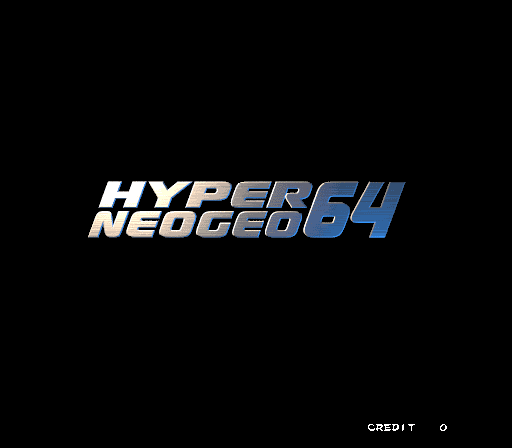 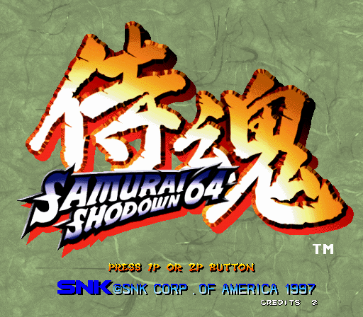 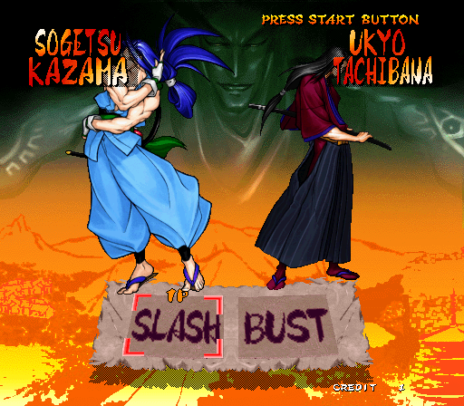 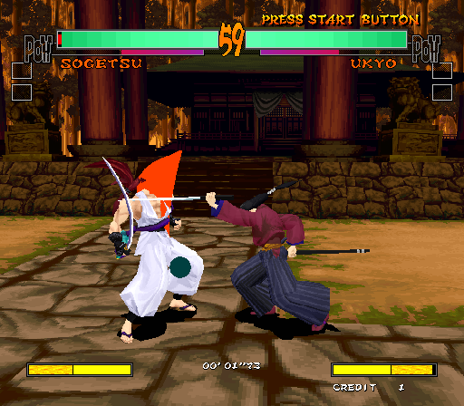 |
| `sams64_2` | 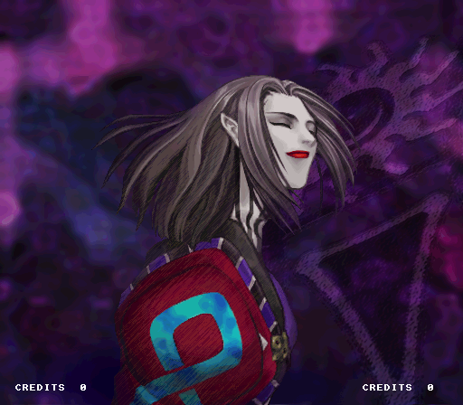 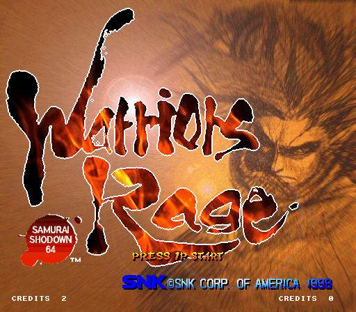 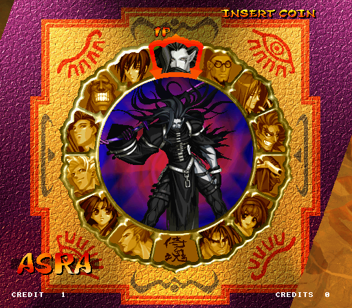 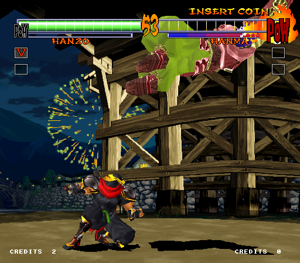 |
| `fatfurwa` | 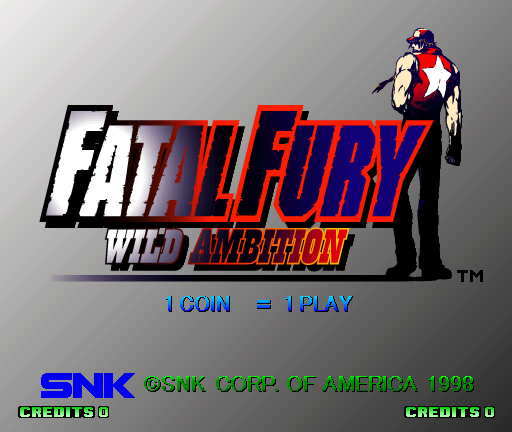 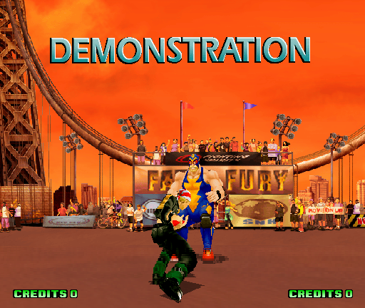 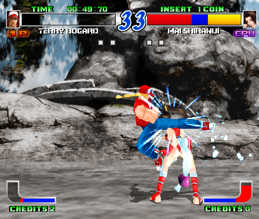 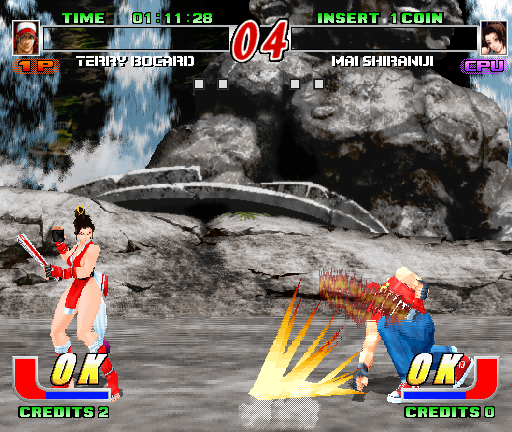 |
| `buriki` | 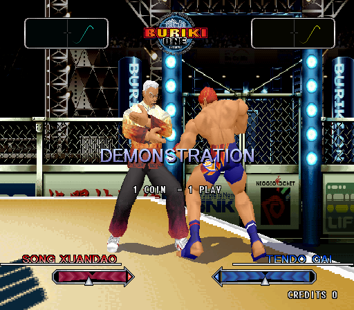 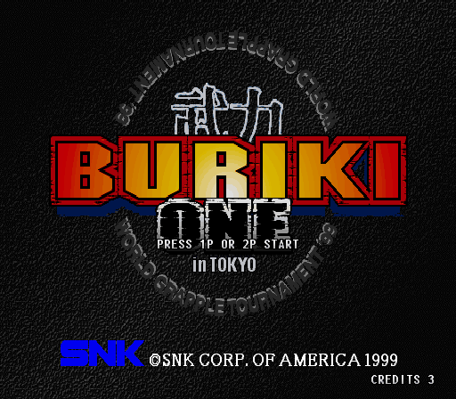 |

## Games

| Name | Year | MAME set | On hardware |
|-|-|-|-|
| Samurai Shodown 64 / Samurai Spirits / Paewang Jeonseol 64 | 1997 | `sams64` | attract and play |
| Samurai Shodown 64: Warriors Rage / Samurai Spirits 2: Asura Zanmaden | 1998 | `sams64_2` | attract and play |
| Fatal Fury: Wild Ambition / Garou Densetsu: Wild Ambition (rev.A) | 1998 | `fatfurwa` | attract and play; heavy 3D scenes slow |
| Buriki One: World Grapple Tournament '99 in Tokyo (rev.B) | 1999 | `buriki` | attract and play; heavy 3D scenes slow |
| Roads Edge / Round Trip RV (rev.B) | 1997 | `roadedge` | attract and play; sustained sounds drop out in races ([Sound](#sound)) |
| Xtreme Rally / Off Beat Racer! | 1998 | `xrally` | attract and play |
| Beast Busters: Second Nightmare | 1998 | `bbust2` | attract and play; heavy 3D scenes slow |

The drive sets' network board is not emulated: as MAME, the core answers its network check
(`docs/MAME_KLUDGES.md`), so each runs as a single cabinet.

## Hardware

| Chip | Function | Status |
|-|-|-|
| NEC VR4300 | main CPU | the MiSTer N64 core's CPU, vendored with changes (`rtl/cpu/vr4300/PROVENANCE.md`) |
| Toshiba TMP87PH40AN (TLCS-870) | IO MCU: inputs, coins, lamps | microcoded from MAME's `tlcs870` (`rtl/io/`), runs the dumped ROM |
| main board I/O | interrupts, DMA, RTC, NVRAM, dual-port RAM | from MAME's driver (`rtl/hng64_io.sv`) |
| NEO64-SCC, NEO64-SPR | four tilemaps, sprites, mixer | from MAME's video (`rtl/video/`) |
| 3D chipset | display list, geometry, rasteriser | written here (SpinalHDL, `rtl/3d/`): a microcoded geometry engine and a rasteriser after SpinalVoodoo, render buffer in DDR3 |
| V53A + L7A1045 | sound CPU and DSP | on the HPS ([MiSTer_ArcadeSoundServer](https://github.com/ppriest/MiSTer_ArcadeSoundServer)): MAME's V53A and L7A1045; `rtl/hng64_sndbridge.sv` carries the main CPU's writes and the board's replies through DDR3; [Sound](#sound) |
| KL5C80A12 | network board | not implemented (`docs/HACKS.md`) |

Video: 25 MHz pixel clock, 512 x 448 visible of 768 x 528, 61.65 Hz, as MAME's screen; MAME gives
no sync positions, so those are this core's (`docs/HACKS.md`). The line rate is 32.6 kHz (768 clocks
at 25 MHz), so analogue output needs a 31 kHz monitor: there is no 15 kHz interlaced mode yet. There
is no composite or S-video output, and the scaler has no adaptive scanline filters, to save area.

### Floorplan

Where the logic sits on the Cyclone V, read from the compiled design with `scripts/floorplan.py` (blocks defined in `scripts/floorplan.json`). One cell per LAB, M10K or DSP site, coloured by the block owning most of it, brighter when fuller. The thin columns are M10K and DSP; the empty area at the top right is the HPS; grey is the MiSTer framework. LUT counts are combinational cells, two per ALM.

Revision `HyperNG64`, fitted 03 Oct 2026:

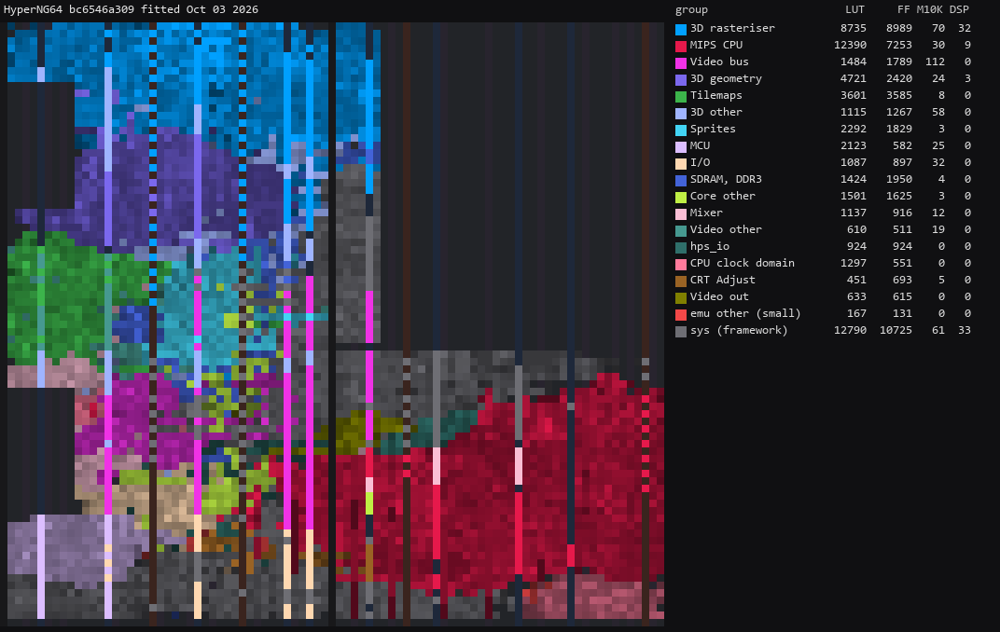

## Installation

`releases/` has a development build: `Arcade-HyperNG64_20261006.rbf` (`7bbc004`, fitter seed 1;
every clock met but the SDRAM reads' capture, `docs/HACKS.md`).

* Copy the `.rbf` to `_Arcade/cores`, or build one with `python scripts/build_staged.py` and copy it
  there as `HyperNG64_<anything>.rbf` (`scripts/deploy.py` does this, with a `mister.env`)
* Put the `.mra` files from `releases/` in `_Arcade` (or an underscore subdirectory)
* Put the MAME ROM sets and the `hng64` BIOS (`hng64.zip`) in `games/mame`
* A 32 MB SDRAM module is required
* For sound: install the sound server, `arcsnd`, from
  [MiSTer_ArcadeSoundServer](https://github.com/ppriest/MiSTer_ArcadeSoundServer) (its README has
  the steps). It waits in the background and plays whenever a Hyper NeoGeo 64 (or Konami Hornet)
  set is loaded ([Sound](#sound))

## Controls

Two players, an 8-way stick and four buttons each, as MAME's `hng64_fight` ports.

| OSD name | Default pad | Keyboard (MAME's defaults), P1 / P2 |
|-|-|-|
| Stick | D-pad | arrows / R F D G |
| Button 1-4 | A, B, X, Y | LCtrl, LAlt, Space, LShift / A, S, Q, W |
| Start | Start | 1 / 2 |
| Coin | Select | 5 / 6 |
| Pause (suspends the CPU) | L | P |
| Service | - | 9 |
| Test (service mode) | - | F2 |

Service and Test have no default pad button; map them in the MiSTer input setup if wanted.

The other boards' controls, from the same OSD buttons (`.mra` names them per set):

* **Drive** (`roadedge`, `xrally`): the wheel from the left stick's X, or the d-pad; the accelerator
  and brake from the stick's Y (up and down), or buttons 1 and 2; shift up and down, two views and
  two music buttons on buttons 3-8.
* **Shoot** (`bbust2`, three players): each player's gun from their left stick (absolute), or moved
  by the d-pad; player 1's also by a mouse. Buttons 1-3 are trigger, pump and bomb, and the mouse's
  left, right and middle buttons are player 1's. Service is a service coin; Test enters service
  mode, where the guns are calibrated.

## OSD speeds

The CPU runs at 75 MHz (the real board's VR4300 runs at 100) and the 3D at 100 MHz; neither is
an OSD setting.

* **Game speed**: Auto (default), or 100% down to 50%.
  * This is a frame-skipping setting: it suppresses the vblank and lets the game somewhat gracefully
    continue rendering the frame while the video stays at 60 Hz.

## Sound

The V53A sound CPU and the L7A1045 DSP are not in the FPGA. They are MAME's code, run on the
DE10-nano's ARM beside Main_MiSTer by `arcsnd`, the sound server shared with the Konami Hornet core
([MiSTer_ArcadeSoundServer](https://github.com/ppriest/MiSTer_ArcadeSoundServer), `src/hng64/`). The core passes it the main CPU's sound
commands, interrupts and sound RAM through a block of DDR3 (`rtl/hng64_sndbridge.sv`; the server's
`docs/PROTOCOL.md` has the layout), and the server plays through MiSTer's audio output at 48 kHz, so
the pitch does not follow the game's speed. The V53A runs at 16 MHz, not MAME's 32
(`docs/MAME_KLUDGES.md`).

Install and start it as its README says: unzip its release onto the SD card's root, or take it from
the downloader DB it names, then run `arcade_hybridsoundserver` from the Scripts menu (again to stop
it), or start it at boot from `linux/user-startup.sh`. It waits until a set starts its sound CPU,
goes quiet within 0.2 s of any core load starting (the bridge's count stops; `rtl/hng64_sndbridge.sv`),
and picks up at the next set. Without it the core still runs, silent: the bridge answers the main
CPU's sound handshake (`docs/HACKS.md`).

Notes:

* The sound is about 80 ms behind the game.
* In heavy passages the emulation needs more than one of the ARM's two cores (Main_MiSTer has the
  other), and the sound has gaps there. It is most noticeable on the drive sets, where a race keeps
  the ARM 90-95% busy and long sounds such as the engine drop out. A faster V33 emulator is the
  planned fix.
* `scripts/mame_sound_trace.py` captures the sound board's traffic from MAME for the server's
  bench, and `scripts/snd_compare.py` compares the bench's output with MAME's.

## Status

Known issues:

* **Sound** needs the sound server (`arcsnd`) running on the ARM, and has gaps in heavy passages
  ([Sound](#sound)).
* **3D throughput**: the 3D is slower than the real board in heavy scenes (fatfurwa's intro,
  buriki's character intros, Beast Busters), so the game slows there; with Game speed at 100% those
  frames lose polygons instead. `docs/ROADMAP.md` has the measurements.
* **Timing not closed** at full speed (clk2x 125 MHz, clk3d 100 MHz): the SDRAM data inputs' capture,
  which no capture phase closes at CL2 and 125 MHz (`docs/HACKS.md`), and on some placements the
  framework scaler's HDMI clock. The current build (seed 1) meets every clock but the SDRAM reads.
* **sams64** sometimes stops on "I/O INITIALIZE SEQUENCE 1 FAILED!!" after a while. Haven't seen this since sound hookup.

`docs/ROADMAP.md` is the plan, `docs/HACKS.md` this core's approximations, `docs/MAME_KLUDGES.md`
what is taken from MAME as is, and `docs/LESSONS_LEARNED.md` what was learnt.

Todo:

- [ ] 3D throughput: keep up with the games' heaviest scenes
- [ ] Close timing at full speed
- [x] Sound (V53A, L7A1045), on the ARM
- [ ] Sound without gaps: a faster V33 emulator (in the sound server)
- [ ] sams64's I/O error
- [ ] 15 kHz interlaced output for CRTs

Resource use (`7bbc004`, seed 1): 36,038 of 41,910 ALMs (86%), 466 of 553 RAM blocks, 71 of 112
DSP blocks, 4 of 6 PLLs.

## Verification

Not PCB-validated. MAME, and YouTube recordings of ports are the accuracy reference.

* Main CPU: the BIOS's first 199,998 instructions match MAME in PC and all 31 registers (`sim/boot_tb`)
* IO MCU: 3,000,000 instructions match MAME's trace (`sim/iomcu_tb`); its decode agrees with MAME's dispatch on every opcode (`scripts/check_tlcs870_dispatch.py`); with MAME's own main-CPU side of the protocol replayed and Start held, the bytes the game reads match MAME's (`iomcu_tb +events`)
* Whole board less the CPU, replaying MAME's boot: frames 400 and 800 pixel-exact, also flipped (`sim/sys_tb`)
* 2D video: every captured layer, the sprites and the mixer pixel-exact to a model of MAME's renderer on captures of `sams64`, `fatfurwa` and `buriki` (`sim/tilemap_tb`, `sim/sprite_tb`, `sim/video_tb`)
* 3D: the geometry engine's setup records identical to its simulator (`sim/geo_tb`); engine, rasteriser and DDR3 arbiter together pixel-exact to the fixed-point model on `sams64` 2500, `buriki` 2500 and `fatfurwa` 1600 and 2500 (`sim/g3d_tb`; `sams64` 600 differs by 4 pixels)
* `.mra` files: rebuilt byte for byte against MAME's `ROM_START` region images (`scripts/build_mra.py`)

## AI Attestation

This core is being developed with heavy use of a frontier coding assistant. Commits written with
it carry a `Co-Authored-By` trailer.

## Acknowledgements

- **Sorgelig** and the **MiSTer-devel team** for the
  [Template_MiSTer](https://github.com/MiSTer-devel/Template_MiSTer) framework and the SDRAM
  controller (`rtl/memory/sdram/`).
- The **MAMEdev team**: David Haywood, Angelo Salese, ElSemi and Andrew Gardner for `hng64`, and the
  device emulations that are this core's specification.
- The **MiSTer N64 core** ([N64_MiSTer](https://github.com/MiSTer-devel/N64_MiSTer)) for the VR4300 (`rtl/cpu/vr4300/`).
- **fayalalebrun** for [SpinalVoodoo](https://github.com/fayalalebrun/SpinalVoodoo)'s triangle setup and span walker (`rtl/3d/`).
- **rmonic79** for CRT Adjust, from [Arcade-Raiden_MiSTer](https://github.com/rmonic79/Arcade-Raiden_MiSTer) (`rtl/video/`).

## Layout

Standard [Template_MiSTer](https://github.com/MiSTer-devel/Template_MiSTer) structure:

| path | contents |
| - | - |
| `sys` | MiSTer framework, vendored from the template, never edited |
| `rtl` | core source; vendored modules carry a `PROVENANCE.md`; `rtl/3d/spinal` is the SpinalHDL source of the 3D's generated Verilog |
| `releases` | `.mra` files |
| `docs` | roadmap, workflow, kludges, hacks, lessons |
| `sim` | ModelSim and Verilator testbenches |
| `scripts` | build, deploy, capture and verification tooling |
| `debug` | reference captures from MAME used as ground truth (gitignored) |
| `roms` | your own MAME sets (gitignored, never committed) |

## License

GPL-3.0 (see `LICENSE`). Imported components keep their own licences; each vendored directory's
`PROVENANCE.md` has the detail, and every modified vendored file states the change in its header.
SpinalVoodoo has no licence yet; one has been asked of its author (`rtl/3d/PROVENANCE.md`).

Game ROMs contain copyrighted material and are not included. Obtaining them is your
responsibility.
